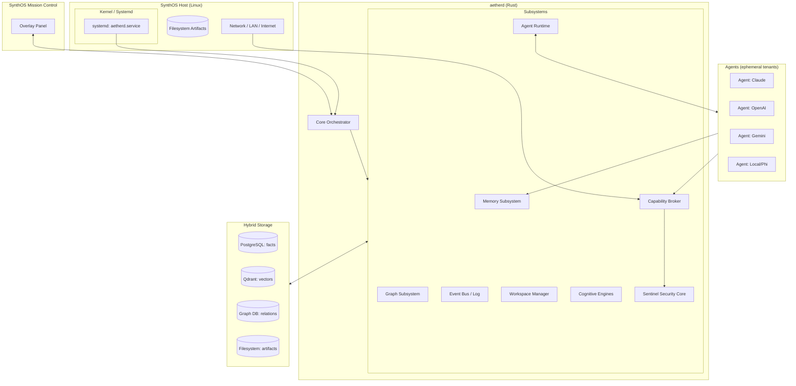
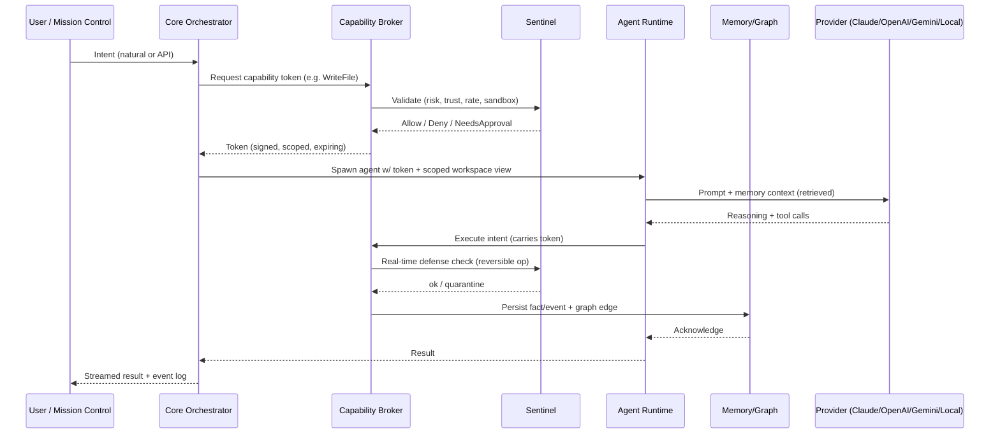

# 01 — AETHER CORE Architecture Overview

## 1. Purpose & Positioning

AETHER CORE is a **systemd-managed Linux daemon** (`aetherd`) that sits between the OS and AI agents. It is the *permanent* cognitive layer; agents are *transient* compute that borrow memory, capabilities, and workspace views from the daemon. This inverts the usual "agent is the app" model: here the OS persists understanding, and agents are fungible.

- **Not** a chatbot: it has no single conversational surface.
- **Not** an agent wrapper: it does not prompt-engineer models; it provisions sandboxes, memory, and capability tokens.
- **Is** a cognition substrate: a durable sensemaking + execution layer embedded in the desktop.

## 2. Layered Architecture

## 3. Control & Data Flow

## 4. Subsystem Responsibilities

| Subsystem | Responsibility |
|-----------|---------------|
| Core Orchestrator | Lifecycle, scheduling, intent routing, consensus of engines |
| Memory Subsystem | 5-tier memory (Working/Episodic/Semantic/Procedural/Reflection), consolidation, crystallization |
| Graph Subsystem | Knowledge graph CRUD, traversals, relationship inference |
| Capability Broker | Token issuance, permission validation, audit, approvals, rate limiting, sandbox enforcement |
| Event Bus / Log | Append-only event log, pub/sub, deterministic replay |
| Agent Runtime | Sandbox provisioning, provider abstraction, memory/workspace views, execution tracing |
| Workspace Manager | Semantic desktop, time machine, intent search |
| Cognitive Engines | Dreams, Attention, Curiosity, Dissonance, Honeypots, Trust Decay, Sim, etc. |
| Sentinel | Security copilot, threat scoring, integrity, forensics, reversible defense |

## 5. Process Model

- `aetherd` runs as an unprivileged service user `aether`, escalating only through capability brokers that delegate to OS primitives (polkit, namespaces, seccomp).
- Each agent runs in its own **sandbox** (namespace + cgroup + seccomp + gVisor option) with a *scoped view* of the filesystem, memory, and graph.
- All cross-boundary calls are **intents** validated by the Capability Broker, never raw syscalls from agents.

## 6. Non-Functional Pillars

- **Durability:** every fact/edge/event survives agent death.
- **Reversibility:** destructive ops are journals with rollback (see Sentinel Real-Time Defense).
- **Observability:** 100% event capture + session replay.
- **Provider-agnostic:** model swap is a config change.
- **Privacy:** local-first; cloud providers are opt-in capabilities.
