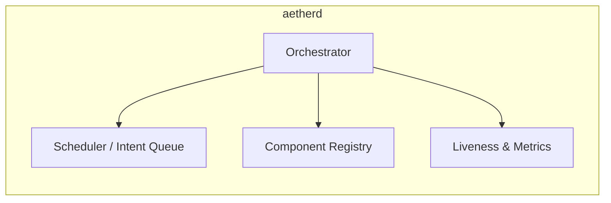
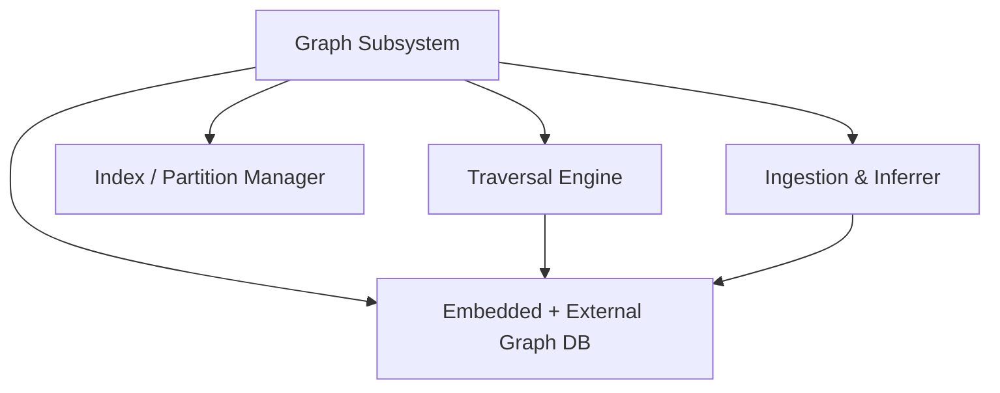
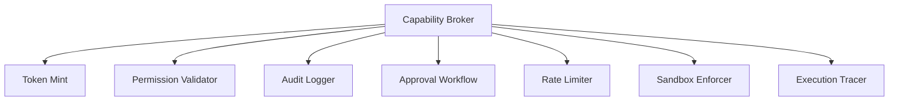
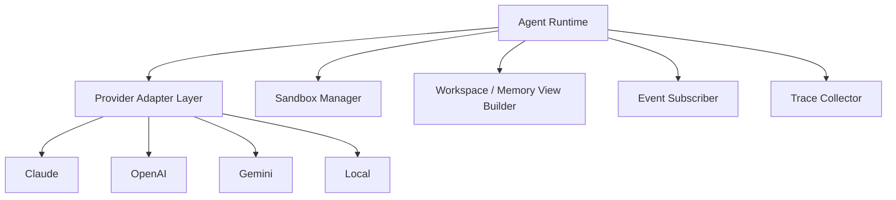
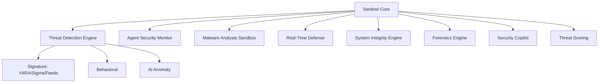
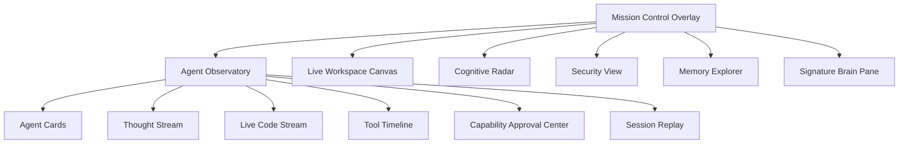
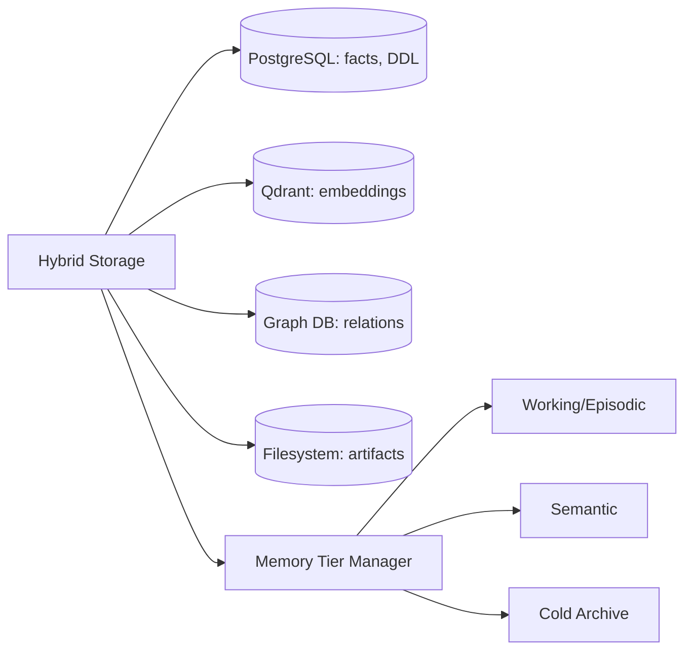

# 02 — Component Diagrams

This document details the internal components of each AETHER CORE subsystem using Mermaid component diagrams.

## 1. Core Daemon Components



## 2. Memory Subsystem

```mermaid
flowchart TB
    MEM[Memory Subsystem] --> WM[Working Memory (Redis/LRU)]
    MEM --> EM[Episodic Store]
    MEM --> SM[Semantic Store]
    MEM --> PM[Procedural Store]
    MEM --> RM[Reflection Store]
    MEM --> CONSOL[Memory Consolidator]
    MEM --> CRYS[Crystallization Engine]
    MEM --> DEDUP[Dedup / Compression]
    CONSOL --> CRYS
    CRYS --> SM
```

## 3. Graph Subsystem



## 4. Capability Broker



## 5. Agent Runtime



## 6. Sentinel Security Core



## 7. SynthOS Mission Control (Frontend)



## 8. Storage Layer Components


