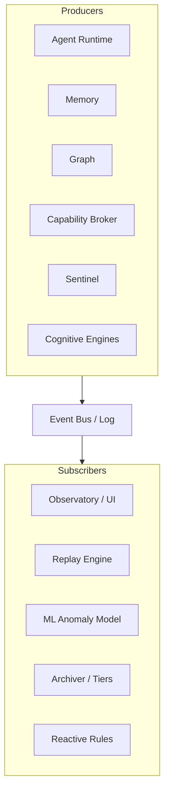
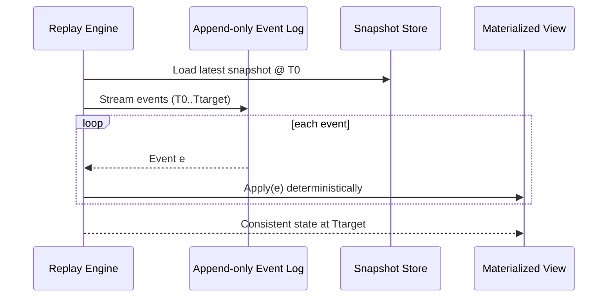
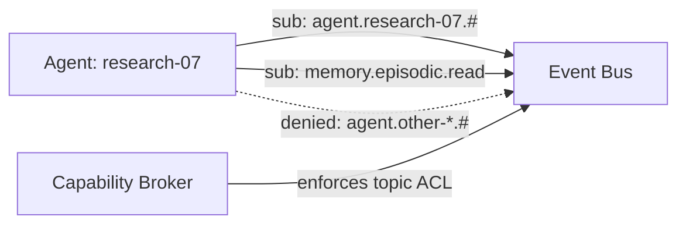
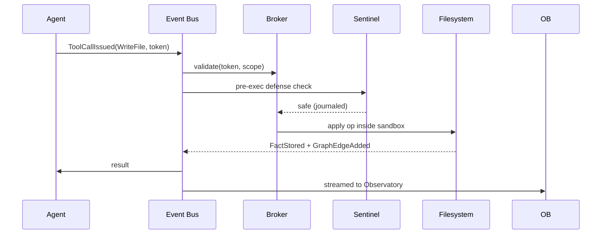

# 03 — Event Flow Diagrams

AETHER CORE is **event-sourced**. Every state mutation, agent action, and cognitive inference is an immutable event on the append-only Event Bus. This enables pub/sub, deterministic replay, and session reconstruction.

## 1. Event Taxonomy

| Event Type | Producer | Example |
|------------|----------|---------|
| `IntentReceived` | Core | user request parsed |
| `CapabilityRequested` | Agent / Core | token request |
| `CapabilityGranted/Denied` | Broker | token minted |
| `AgentSpawned/Terminated` | Runtime | sandbox created |
| `ThoughtEmitted` | Agent | reasoning token |
| `ToolCallIssued` | Agent | WriteFile invoked |
| `FactStored` | Memory | semantic fact persisted |
| `GraphEdgeAdded` | Graph | RELATED_TO edge |
| `CognitiveEvent` | Engines | Dream/Dissonance/Serendipity |
| `SecurityAlert` | Sentinel | anomaly detected |
| `MemoryConsolidated` | Memory | crystallization |

## 2. Publish / Subscribe Topology



## 3. Replay Flow (deterministic reconstruction)



## 4. Agent Subscription Model

Agents subscribe to **scoped topics** only (zero-trust pub/sub). Topic names are capability-prefixed.



## 5. End-to-End Tool-Call Event Flow



## 6. Event Schema (canonical)

```json
{
  "id": "evt_01H...",
  "ts": "2026-07-11T08:00:00Z",
  "type": "ToolCallIssued",
  "producer": "agent:research-07",
  "topic": "agent.research-07.tools",
  "trace_id": "trace_abc",
  "capability": "WriteFile",
  "payload": { "path": "/ws/proj/notes.md", "bytes": 2048 },
  "hash": "sha256:...",
  "prev": "evt_01H_prev"
}
```

Events are content-addressed (`hash` chained to `prev`) to guarantee tamper-evidence used by the Forensics Engine.
