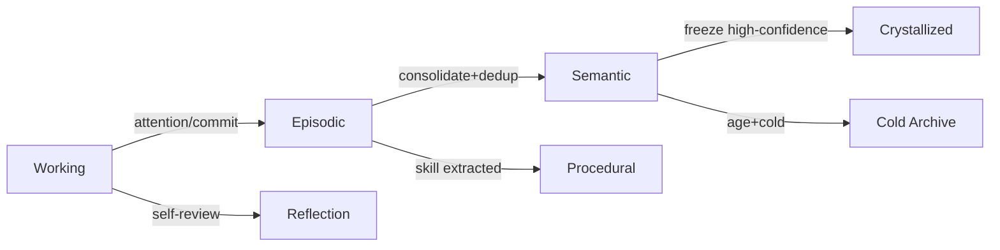

# 05 — Memory Schema

AETHER CORE maintains **five memory classes** plus a Cold archive tier. Memory is the durable cognitive backbone; agents read/write through scoped views.

## 1. Memory Classes

| Class | Persistence | Purpose | Example |
|-------|-------------|---------|---------|
| **Working** | Volatile (Redis/TTL) | Active context, scratch | current task plan, recent tokens |
| **Episodic** | Medium (Postgres) | Time-stamped experiences | "Fixed login bug at 14:02" |
| **Semantic** | Long (Postgres + Qdrant) | De-duplicated facts/knowledge | "Project X uses Postgres" |
| **Procedural** | Long | How-to / skills / playbooks | "Deploy flow for service Y" |
| **Reflection** | Long | Self-evaluation, theories | "My approach to X was wrong" |
| **Cold** | Archive | Compressed, rarely accessed | 6-month-old logs |

## 2. Memory Record Schema

```sql
CREATE TABLE memory_records (
    id            UUID PRIMARY KEY,
    tier          SMALLINT NOT NULL,          -- 0..5
    kind          TEXT NOT NULL,              -- fact|episode|procedure|reflection
    content       JSONB NOT NULL,             -- text / structured / artifact_ref
    embedding_id  UUID,                        -- -> qdrant
    timestamp     TIMESTAMPTZ NOT NULL DEFAULT now(),
    salience      REAL NOT NULL DEFAULT 0.5,  -- attention weight
    confidence    REAL NOT NULL DEFAULT 1.0,
    created_by    UUID NOT NULL,              -- actor
    discovered_by UUID,
    accesses      BIGINT NOT NULL DEFAULT 0,
    expires_at    TIMESTAMPTZ,
    superseded_by UUID,                        -- -> memory_records.id
    compressed    BOOLEAN DEFAULT FALSE
);
CREATE INDEX ix_mem_tier_ts ON memory_records(tier, timestamp DESC);
CREATE INDEX ix_mem_sal ON memory_records(salience DESC);
```

## 3. Relationship Types (canonical)

All edges between memory records and graph nodes use these typed relationships:

| Relation | Meaning |
|----------|---------|
| `BELONGS_TO` | record node is part of a parent context |
| `DEPENDS_ON` | requires another node to hold |
| `RELATED_TO` | loose semantic association |
| `CREATED_BY` | authorship / origin |
| `DISCOVERED_BY` | an agent/person surfaced it |
| `MENTIONS` | references another entity in content |
| `SUPERSEDES` | newer version replaces older |
| `PART_OF` | structural containment |
| `REFERENCES` | explicit citation/link |
| `BLOCKED_BY` | cannot proceed until target resolved |
| `ENABLES` | makes another node possible |

## 4. Relationship Edge Schema

```sql
CREATE TABLE memory_relations (
    id         UUID PRIMARY KEY,
    from_id    UUID NOT NULL REFERENCES memory_records(id),
    to_id      UUID NOT NULL REFERENCES memory_records(id),
    relation   TEXT NOT NULL CHECK (relation IN (
        'BELONGS_TO','DEPENDS_ON','RELATED_TO','CREATED_BY','DISCOVERED_BY',
        'MENTIONS','SUPERSEDES','PART_OF','REFERENCES','BLOCKED_BY','ENABLES')),
    weight     REAL DEFAULT 1.0,
    created_at TIMESTAMPTZ DEFAULT now(),
    UNIQUE (from_id, to_id, relation)
);
```

## 5. Consolidation & Crystallization

- **Consolidator** promotes Episodic → Semantic when salience×accesses crosses a threshold and duplicates are merged (dedup by embedding cosine < 0.92).
- **Crystallization** freezes high-confidence Semantic facts into immutable `CrystallizedFact` entries; downstream reads prefer crystallized truth (see Truth Engine, 20).
- **Trust Decay** reduces `confidence` of stale Semantic facts linearly with age unless re-validated.

## 6. Memory Tier Promotion Diagram


