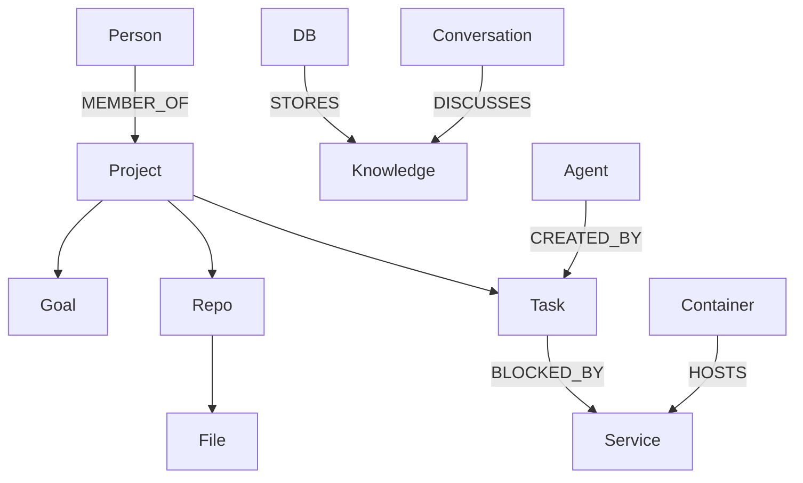

# 06 — Knowledge Graph Schema

The graph is the **relational spine** of AETHER CORE, linking every entity the system understands. It complements (not replaces) the vector store: vectors give similarity; the graph gives structure, causality, and provenance.

## 1. Node Types

| Node | Description | Key Attributes |
|------|-------------|----------------|
| **Projects** | Top-level initiatives | name, status, goal_ref |
| **Repos** | Git repositories | url, default_branch, language |
| **Files** | Filesystem artifacts | path, hash, size, mtime |
| **Tasks** | Units of work | title, status, assignee |
| **Goals** | Objectives (decomposable) | criteria, progress |
| **Agents** | Running/known agents | provider, persona |
| **Conversations** | Dialogue threads | topic, participants |
| **Documents** | Long-form artifacts | title, doc_type |
| **People** | Owners/collaborators | handle, role |
| **Services** | Running services | kind, endpoint, health |
| **Containers** | Docker/Podman units | image, state |
| **DBs** | Databases | engine, version |
| **Knowledge** | Crystallized facts/concepts | statement, confidence |

## 2. Edge Types

Reuses the 11 relations from [05-memory-schema.md](./05-memory-schema.md) plus structural/semantic edges:

`BELONGS_TO, DEPENDS_ON, RELATED_TO, CREATED_BY, DISCOVERED_BY, MENTIONS, SUPERSEDES, PART_OF, REFERENCES, BLOCKED_BY, ENABLES`

Plus graph-native edges: `CONTAINS` (Repo→File), `HOSTS` (Container→Service), `STORES` (DB→Knowledge), `DISCUSSES` (Conversation→Knowledge), `MEMBER_OF` (Agent→Project).

## 3. Node Model (generic)

```sql
CREATE TABLE graph_nodes (
    id         UUID PRIMARY KEY,
    label      TEXT NOT NULL,
    kind       TEXT NOT NULL CHECK (kind IN (
        'Project','Repo','File','Task','Goal','Agent','Conversation',
        'Document','Person','Service','Container','DB','Knowledge')),
    props      JSONB NOT NULL DEFAULT '{}',
    embedding_id UUID,
    created_at TIMESTAMPTZ DEFAULT now(),
    updated_at TIMESTAMPTZ DEFAULT now()
);
CREATE INDEX ix_node_kind_label ON graph_nodes(kind, label);
```

## 4. Edge Model

```sql
CREATE TABLE graph_edges (
    id         UUID PRIMARY KEY,
    from_id    UUID NOT NULL REFERENCES graph_nodes(id),
    to_id      UUID NOT NULL REFERENCES graph_nodes(id),
    relation   TEXT NOT NULL,
    weight     REAL DEFAULT 1.0,
    provenance UUID,                       -- memory_records.id
    created_at TIMESTAMPTZ DEFAULT now(),
    UNIQUE (from_id, to_id, relation)
);
CREATE INDEX ix_edge_to ON graph_edges(to_id, relation);
CREATE INDEX ix_edge_from ON graph_edges(from_id, relation);
```

## 5. Example Traversal

> "What tasks are BLOCKED_BY a failing Service owned by an Agent with low reputation?"

```cypher
MATCH (t:Task)-[:BLOCKED_BY]->(s:Service)<-[:HOSTS]-(c:Container)
MATCH (s)-[:CREATED_BY]->(a:Agent)
WHERE a.reputation.trust < 0.4 AND s.health = 'unhealthy'
RETURN t, s, a
```

## 6. Graph Topology Diagram


