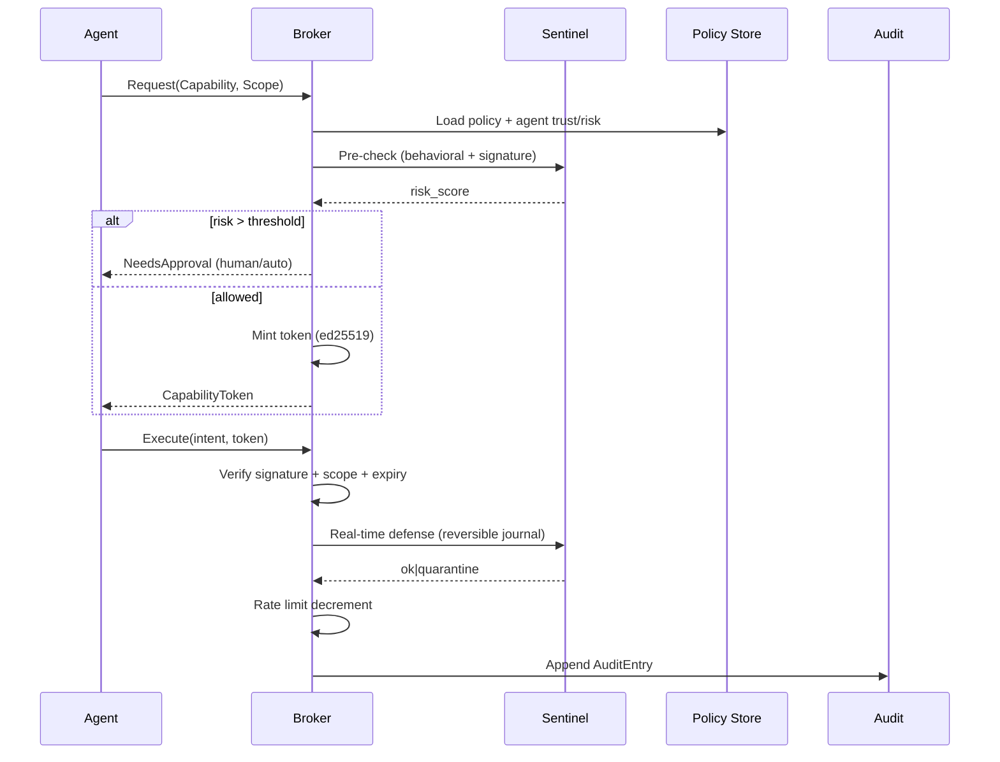

# 07 — Capability Broker Design

The Capability Broker is the **zero-trust enforcement point** for every agent action. No agent touches the host directly; it acts only through a signed, scoped, expiring capability token.

## 1. Capability Token Model

A token is an **intent-bearing, signed credential**:

```rust
pub struct CapabilityToken {
    pub id: TokenId,
    pub agent_id: AgentId,
    pub capability: Capability,
    pub scope: Scope,            // path prefix / service id / rate bucket / topic
    pub permissions: PermissionSet, // allow/deny conditions + constraints
    pub issued_at: DateTime<Utc>,
    pub expires_at: DateTime<Utc>,
    pub nonce: u128,
    pub signature: Ed25519Signature,  // broker private key
}
```

## 2. Capability Catalog

| Capability | Description | Default Risk |
|------------|-------------|--------------|
| `ReadFile` | Read scoped file paths | Low |
| `WriteFile` | Write scoped paths | Medium |
| `SearchCode` | Semantic/lexical code search | Low |
| `ExecuteCommand` | Run command in sandbox | High |
| `AccessDatabase` | Query managed DBs | High |
| `UseBrowser` | Headless browser nav | Medium |
| `UseGit` | Clone/commit/push | Medium |
| `UseDocker` | Container lifecycle | High |
| `UseKubernetes` | Cluster ops | Critical |
| `NetworkAccess` | Egress to internet | Medium |
| `SystemControl` | Host-level control | Critical |
| `Email` | Send/read mail | Medium |
| `Calendar` | Read/write calendar | Medium |
| `Notes` | Personal notes CRUD | Low |
| `Filesystem` | General FS ops | Medium |
| `MCP` | Model Context Protocol servers | Medium |
| `Custom` | User-defined capability | Variable |

## 3. Permission Validation Flow



## 4. Audit Logging

- Every granted/denied/executed action writes an immutable `AuditEntry` to the Event Bus.
- Destructive ops carry `before` snapshot → **reversible**.
- Audit stream is content-chained (see 03-event-flow) for tamper-evidence.

## 5. Approval Workflows

| Level | Trigger | Decision |
|-------|---------|----------|
| L0 Auto | risk < 0.2 | Broker auto-grants |
| L1 Quiet | 0.2–0.5 | Grant, notify Observatory |
| L2 Prompt | 0.5–0.8 | Human/Mission Control approval |
| L3 Lock | > 0.8 | Deny + Sentinel alert |

## 6. Rate Limits

Per-token, per-capability **token-bucket** with hierarchical quotas:

```yaml
limits:
  global: { tokens_per_min: 600 }
  ExecuteCommand: { per_agent_per_min: 30, burst: 5 }
  NetworkAccess: { per_agent_per_hour: 2000 }
  UseKubernetes: { per_agent_per_day: 50 }
```

## 7. Sandbox Enforcement

- `ExecuteCommand` / `UseDocker` / `UseKubernetes` execute inside namespaces + cgroups + seccomp (or gVisor).
- Filesystem scope is a bind-mounted read/write overlay; writes outside scope fail at syscall layer, not just policy layer.
- Network scope enforced via eBPF/VPN split-tunnel rules.

## 8. Execution Tracing

Each token carries a `trace_id`. All actions, child spawns, and sub-intents are correlated under the trace for the Observatory "tool usage timeline" and session replay. Trace spans are exported to OpenTelemetry.
