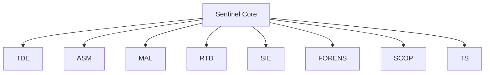
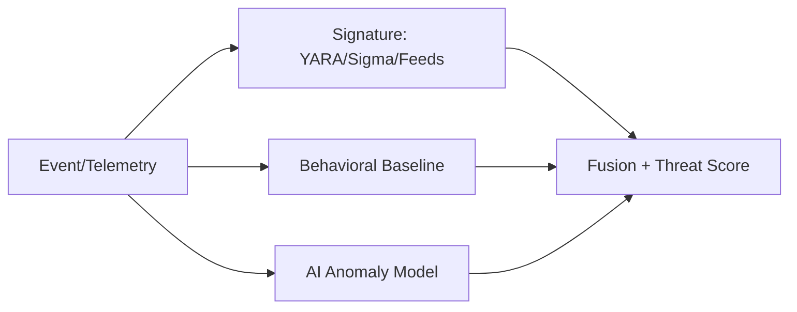

# 08 — Security Design & AETHER SENTINEL

AETHER CORE is built **zero-trust**: no implicit trust of agents, providers, services, or even the user session. `aetherd` runs unprivileged and escalates only through brokered capabilities. **AETHER SENTINEL** is the integrated security architecture.

## 1. Zero-Trust Model

- **Never trust, always verify.** Every request requires a valid, scoped, unexpired token.
- **Least privilege.** Agents get the minimal capability set; scope shrinks over time via Trust Decay.
- **Micro-segmentation.** Each agent sandbox is network-isolated; inter-agent calls go through the broker.
- **Assume breach.** All actions are journaled and reversible; forensics reconstruct any incident.
- **Continuous attestation.** Agent/Service trust scores are recomputed on every event.

## 2. Sentinel Core

Orchestrates all security subsystems; exposes a single policy evaluation API consumed by the Capability Broker.

## 3. Threat Detection Engine

Three detection lanes fused into a composite risk score:

| Lane | Source | Notes |
|------|--------|-------|
| **Signature** | YARA rules, Sigma rules, threat feeds (MISP/Abuse.ch) | Fast, high-precision |
| **Behavioral** | eBPF syscall traces, capability-use baselines, anomaly deviation | Per-agent baseline |
| **AI Anomaly** | LLM/embedding classifier over event stream + tool-call semantics | Catches novel patterns |

## 4. Agent Security Monitor

Per-agent dynamic scores:
- **Risk score** (0–1): recent failed/denied ops, scope creep, anomalous tool use.
- **Trust score** (0–1): successful completions, corroborated facts, clean history.
- **Capability score**: how much of granted scope is actually used correctly.

Feeds directly into Broker approval tiers (07).

## 5. Malware Analysis Sandbox

Unverified artifacts (downloads, generated code, attachments) routed to an **air-gapped gVisor sandbox** for static (YARA/PE/ELF) + dynamic (syscall, network) analysis before they touch the workspace.

## 6. Real-Time Defense (Auditable + Reversible)

- Destructive/risky ops are wrapped in a **journaled transaction**: capture `before` state, apply, allow rollback.
- Defense actions (quarantine agent, freeze token, revoke network) are themselves events → fully auditable and reversible by an operator.
- "Circuit breaker" auto-isolates an agent when risk crosses L3.

## 7. Memory-Aware Security

Security policy is informed by memory: known-good patterns (Semantic) raise trust; flagged Indicators of Compromise (episodic/reflection) lower it. Honeypots (see 20) feed Sentinel via synthetic high-value nodes.

## 8. System Integrity Engine

- Periodic **measurement** of critical files (hash chain), configs, and daemon binaries.
- eBPF-based runtime integrity monitoring (unexpected privilege escalation, tampered event log).
- On divergence → SystemControl token revocation + alert.

## 9. Forensics Engine

- Replays the content-chained Event Log (03) to reconstruct exact incident state.
- Correlates by `trace_id` across agents, memory, and graph.
- Produces incident timeline + root-cause graph.

## 10. Security Copilot

An agent (high-trust, read-only Sentinel scope) that explains alerts in natural language, proposes reversible mitigations, and drafts policies — all through the normal Broker path.

## 11. Threat Scoring

Composite score `T = w1*Sig + w2*Beh + w3*AI + w4*AgentRisk - w5*Trust`, continuously recomputed, used for auto-tiering and dashboards.

## 12. Key Management

- Broker signing key: ed25519 in a kernel keyring / TPM where available; rotation every 30 days.
- Per-agent ephemeral keys for sandbox comms; never persisted in plaintext.
