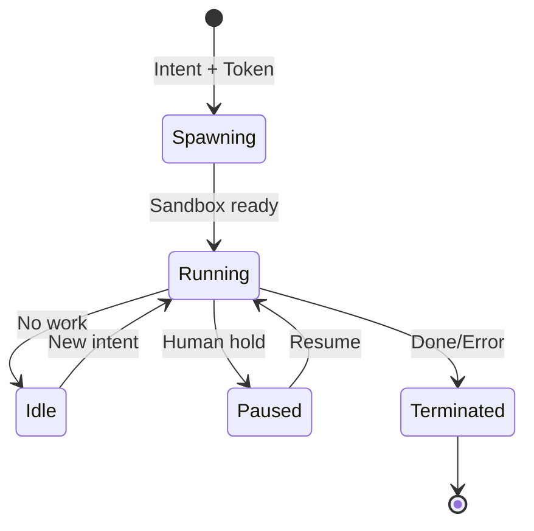

# 09 — Agent Runtime Design

The Agent Runtime turns provider APIs (Claude/OpenAI/Gemini/Local) into **scoped, sandboxed cognitive tenants** of AETHER CORE. Agents are fungible; the daemon retains identity and memory.

## 1. Lifecycle



## 2. Sandbox

Each agent executes in an isolated environment:
- **Namespaces:** PID, mount, network, IPC, UTS.
- **cgroups v2:** CPU/mem/IO caps.
- **seccomp / gVisor:** syscall allow-list.
- **Overlay FS:** scoped, read/write view of workspace only.
- **Network:** split-tunnel via eBPF; default deny egress unless `NetworkAccess` token.

## 3. Provider-Agnostic Adapter

```rust
pub trait LlmProvider: Send + Sync {
    fn kind(&self) -> ProviderKind;
    async fn complete(&self, req: CompletionRequest,
                      ctx: MemoryContext) -> Result<Completion>;
    async fn stream(&self, req: CompletionRequest,
                    ctx: MemoryContext) -> Result<Stream<Thought>>;
}

pub struct CompletionRequest {
    pub system: Persona,
    pub messages: Vec<Message>,
    pub tools: Vec<ToolSpec>,     // capability-backed
    pub model_routing: RoutingHint,
}
```

Adapters: `ClaudeAdapter`, `OpenAiAdapter`, `GeminiAdapter`, `LocalAdapter` (llama.cpp/Phi). Routing decided by the Model Routing engine (20).

## 4. Memory / Workspace Views

Agents never see the global store — they receive a **scoped projection**:
- Working memory window sized by token budget.
- Graph neighborhood limited to tokens the agent's scope grants.
- Episodic/Semantic retrieved by relevance + capability ACL.

```rust
pub struct AgentView {
    pub working: WorkingWindow,
    pub graph_neighborhood: Vec<GraphNode>,
    pub memory_access: AccessPolicy,   // read/write tiers allowed
}
```

## 5. Capability Tokens

Agents request tokens per action (07). The runtime attaches the token to every tool call so the Broker can verify without agent cooperation.

## 6. Event Subscriptions

Agents subscribe to capability-scoped topics (03). They cannot subscribe to other agents' private topics; the Broker enforces topic ACLs.

## 7. Execution Tracing

Each agent run is a `trace_id` tree:
- Thought stream (token emissions) → `ThoughtEmitted`.
- Tool usage → `ToolCallIssued` with token + result.
- Spawns (sub-agents) → child traces.
Collected for the Observatory thought/code stream and session replay.

## 8. Provider Message Normalization

| Field | Claude | OpenAI | Gemini | Local |
|-------|--------|--------|--------|-------|
| system | system block | system msg | system_instruction | system prompt |
| tools | tools[] | tools[] (fn) | function_declarations | custom |
| stream | SSE deltas | SSE deltas | SSE | token stream |

Normalized into `Completion`/`Stream<Thought>` before reaching the agent loop.

## 9. Failure & Recovery

- **Timeouts / rate-limit:** runtime requeues intent with backoff.
- **Sandbox crash:** state preserved in Event Log; agent respawned with same token scope.
- **Provider outage:** Model Routing fails over to next provider transparently.
