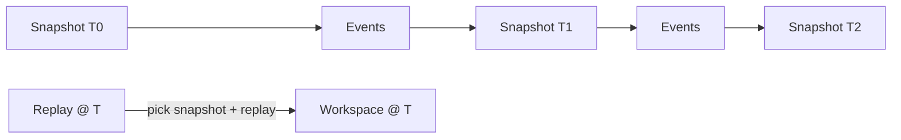
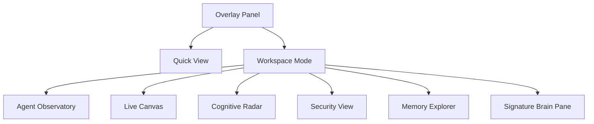

# 10 — Workspace Model & SynthOS Mission Control

## Part A — Workspace Model (Semantic Desktop)

### 1. Semantic Desktop
The workspace is not a folder tree; it is a **semantic space** where files, conversations, tasks, and knowledge are interlinked in the graph. Search and navigation are intent-based, not path-based.

- Every artifact is a `File`/`Document`/`Knowledge` graph node with embeddings.
- Cross-references auto-created by ingest (DISCOVERED_BY, MENTIONS, REFERENCES).
- Context is assembled on demand from graph neighborhoods + memory retrieval.

### 2. Workspace Time Machine
Each mutation is an event (03); the workspace can be materialized at any point.

- Periodic snapshots (Postgres + filesystem delta) + event replay for fine-grained restore.
- "Diff workspace between T_a and T_b" reconstructs added/removed/changes.

### 3. Intent-Based Search
`search("where we discussed auth refactor")` → graph traversal + Qdrant semantic + episodic filter, ranked by salience/recency. Returns unified results across files, memory, conversations.

## Part B — SynthOS Mission Control (Frontend)

A **right-side sliding overlay panel** (not a floating window) that docks to the SynthOS desktop edge. It is the primary operator surface for the cognitive workspace.

### 1. Layout
- Slides from right; collapsible to a thin strip.
- Two **Workspace Modes**:
  - **Quick View** — compact glance: active agents, alerts, cognitive radar blips.
  - **Workspace Mode** — full control: canvas, observatories, security, memory.

### 2. Agent Observatory
- **Agent Cards** — one per agent: provider, state, trust/risk, current goal.
- **Live Thought Stream** — token-by-token reasoning.
- **Live Code Stream** — code the agent writes/edits in real time.
- **Browser Activity** — live page/screenshot for `UseBrowser` agents.
- **Tool Usage Timeline** — chronological capability calls with tokens.
- **Capability Approval Center** — L2/L3 prompts; one-click approve/deny with context.
- **Session Replay** — scrub any past agent session from the Event Log.

### 3. Live Workspace Canvas
Force-directed graph of Projects/Repos/Files/Tasks/Agents; click to expand neighborhoods; live edges as relations form.

### 4. Cognitive Radar
Radar chart of active cognitive engines: Attention, Curiosity, Dissonance, Serendipity, Trust Decay activity.

### 5. Security View
Fed by Sentinel: threat score gauge, active alerts, agent risk/trust bars, recent forensic events, honeypot triggers.

### 6. Memory Explorer
Browse/query memory tiers; visualize consolidation and crystallization; inspect provenance and relations.

### 7. Visual Style
- **Themes:** Catppuccin Mocha, Tokyo Night, Nord, Gruvbox, Dracula (runtime switch).
- **Fonts:** JetBrains Mono / Geist Mono for code & data; a clean sans for prose.
- **Material:** blur / acrylic / glassmorphism, rounded corners (12–16px), smooth 200–300ms motion (spring easing).
- **Signature Feature — Brain Pane:** a center visualization of the "mind" — a living neural/constellation render of active thoughts, memories firing, attention focus, and agent sub-networks, animated as a brain-like cortical map. It is the emotional/intuitive anchor of the UI: you *see* the system thinking.

