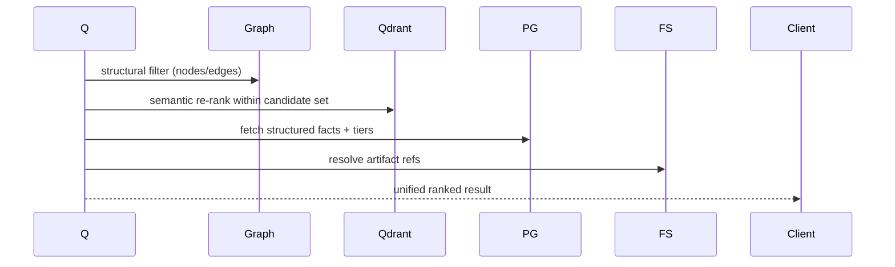

# 12 — Database Schema (Hybrid Storage)

AETHER CORE uses **four cooperating stores**, each for its strength. The "Memory Tier Manager" routes records across them by access pattern and value.

## 1. Store Responsibilities

| Store | Role | Data |
|-------|------|------|
| **PostgreSQL** | Facts, events, structured relations, tiers | memory_records, graph_nodes/edges, events, audit, agents |
| **Qdrant** | Vector similarity | embeddings for memory/graph nodes |
| **Graph DB** (Neo4j/Polyphemus) | Relationship traversal | nodes + typed edges |
| **Filesystem** | Artifacts (blobs) | raw files, snapshots, model caches |

## 2. PostgreSQL — Facts / Events / Agents

```sql
CREATE TABLE agents (
    id UUID PRIMARY KEY, name TEXT, provider TEXT,
    trust REAL DEFAULT 0.5, risk REAL DEFAULT 0.0,
    reputation JSONB, state TEXT, created_at TIMESTAMPTZ DEFAULT now()
);
CREATE TABLE events (
    id UUID PRIMARY KEY, ts TIMESTAMPTZ, type TEXT, producer TEXT,
    topic TEXT, trace_id TEXT, payload JSONB, hash TEXT, prev TEXT
);
CREATE INDEX ix_evt_ts ON events(ts DESC);
CREATE INDEX ix_evt_trace ON events(trace_id);
CREATE TABLE audit (
    id UUID PRIMARY KEY, token_id UUID, action TEXT,
    before JSONB, after JSONB, reversible BOOLEAN, decided_by TEXT
);
```

## 3. PostgreSQL — Memory (see 05 for full table)

Tiers stored with `tier` flag; Cold tier may be offloaded to partitioned tables by month.

## 4. Qdrant — Vector Collections

```yaml
collections:
  memory_embeddings:
    vector_size: 1536
    distance: Cosine
    payload_index: [tier, kind, agent_id, timestamp]
  graph_embeddings:
    vector_size: 1536
    distance: Cosine
    payload_index: [kind, label]
```

## 5. Graph DB — Nodes/Edges (see 06)

Cypher DDL equivalent; indexes on kind/label and edge endpoints.

## 6. Filesystem — Artifacts

```
/var/lib/aether/artifacts/<uuid>      # raw blobs (content-addressed)
/var/lib/aether/snapshots/<ts>/       # workspace time-machine deltas
/var/lib/aether/models/               # local model weights cache
```

## 7. Memory Tiers & Promotion


## 8. Compression / Dedup / Crystallization

- **Dedup:** semantic facts merged when cosine(emb) < 0.92; older kept as `superseded_by`.
- **Compression:** Cold-tier records stored with zstd; episodic summaries generated by a consolidator agent.
- **Crystallization:** high-confidence Semantic facts frozen into immutable `CrystallizedFact` (append-only, versioned). Truth Engine prefers crystallized over volatile facts.

## 9. Hybrid Query Pattern


