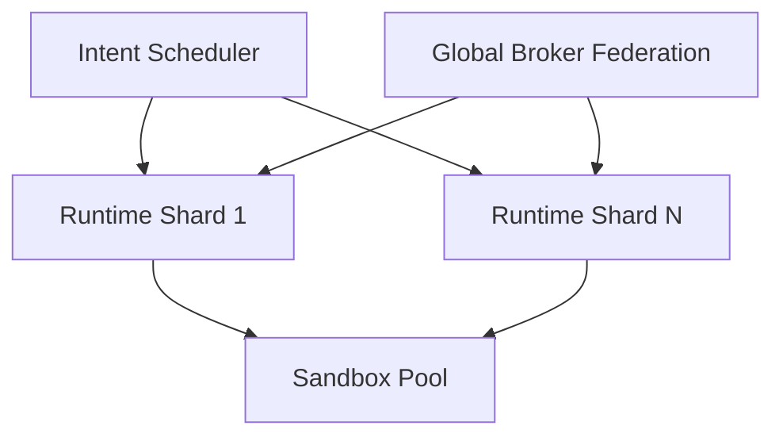

# 17 — Scaling Roadmap

Targets: **100+ concurrent agents**, **millions of graph nodes**, **sub-second retrieval**, **GPU acceleration**, **distributed deployment**.

## 1. Horizontal Agent Scaling
- Agent Runtime sharded by `agent_id` hash; stateless runtime workers behind a scheduler.
- Sandbox pools pre-warmed (microVMs via Firecracker) for <200ms spawn.
- Per-shard Broker; global policy cache with CRDT sync.

## 2. Graph at Millions of Nodes
- Partition graph by `kind` + shard key; use a distributed graph (Nebula/JanusGraph) or sharded Neo4j.
- Hot subgraph (active projects/agents) cached in-memory (Rockingcache).
- Precomputed materialized neighborhoods for frequently queried nodes.

## 3. Sub-Second Retrieval
- Qdrant on-GPU (HNSW + IVF) with quantized vectors (int8) → <10ms@1M.
- Two-stage retrieval: graph structural filter → vector re-rank (12).
- Read replicas + edge caching; cold tier on object storage (S3/MinIO).

## 4. GPU Acceleration
- Embedding generation batched on GPU (local models).
- Vector search offload to GPU (RAFT / cuVS).
- Speculative decoding for Local provider; shared KV cache across agents.

## 5. Distributed Deployment
- `aetherd` as a cluster: Core (consensus via Raft), Storage, Runtime, Sentinel tiers.
- Event log as partitioned, replicated WAL (Kafka/RisingWave optional).
- Federated graph sync between nodes with selective, capability-gated sharing.
- Geo-aware agent placement; network policy via service mesh (zero-trust mTLS).

## 6. Capacity Planning Guide

| Metric | MVP | Scale Target |
|--------|-----|--------------|
| Agents | 1–5 | 100+ |
| Graph nodes | 10k | 5M+ |
| Vectors | 100k | 50M+ |
| p95 retrieval | 200ms | <800ms (cold) / <50ms (hot) |
| Event throughput | 1k/s | 100k/s |

## 7. Cost & Efficiency
- Cold-tier compression + dedup cuts storage ~60%.
- Crystallization reduces repeated LLM re-derivation.
- Spot/Preemptible GPU for embedding batch jobs.
