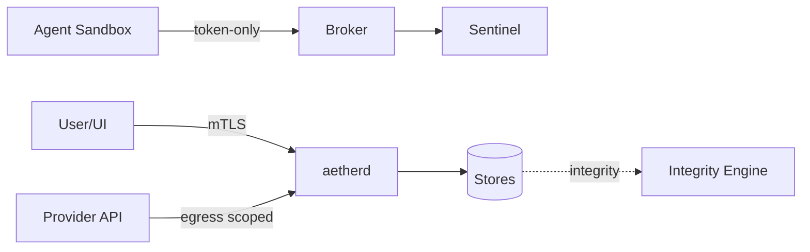

# 18 — Threat Model

STRIDE-aligned threat model for AETHER CORE. Assumes **hostile agents, compromised providers, and untrusted content** are in scope (zero-trust).

## 1. Assets
- Memory store (facts, secrets, reflections).
- Knowledge graph (structure of the user's life/work).
- Capability signing keys & tokens.
- Event log integrity (forensics source of truth).
- Host filesystem & network.

## 2. Adversaries
| Actor | Capability | Motivation |
|-------|-----------|-----------|
| Malicious agent | Runs with granted tokens | Exfiltrate, corrupt, pivot |
| Compromised provider | Injects malicious tool output | Supply-chain / prompt injection |
| Untrusted content | Web/downloads/attachments | Malware, prompt injection |
| Local attacker | User-space access | Escalate via daemon |
| Remote attacker | Network egress abuse | C2, data exfil |

## 3. STRIDE Analysis

| Threat | Vector | Mitigation |
|--------|--------|-----------|
| **S**poofing | Forged token/agent id | ed25519 signatures, nonce, expiry |
| **T**ampering | Event-log edit, graph poison | Hash-chained log, integrity engine, eBPF |
| **R**epudiation | Unlogged action | 100% audit + content-chained events |
| **I**nfo disclosure | Over-broad scope read | Least-privilege tokens, scoped views, ACL topics |
| **D**enial | Agent flood, resource exhaustion | Rate limits, cgroups, circuit breakers |
| **E**levation | Sandbox escape, cap creep | seccomp/gVisor, scope shrink, Trust Decay |

## 4. Abuse Cases
- **Token scope creep:** agent requests `WriteFile /` repeatedly → Sentinel behavioral baseline flags.
- **Prompt injection via content:** malicious doc instructs agent to exfiltrate → Memory-Aware Security + honeypot nodes detect divergence.
- **Log tampering:** attacker edits event segments → hash chain break → Integrity Engine alarms.
- **Sandbox escape:** kernel 0-day → runtime integrity + minimal ambient caps limit blast radius.
- **Model supply-chain:** provider returns trojaned tool call → Malware Sandbox + Signature detection on artifacts.

## 5. Trust Boundaries

## 6. Residual Risk & Acceptances
- Kernel 0-day escape: accepted with minimal caps + rapid patching SLA.
- Provider compromise: mitigated by local-first default; cloud opt-in.
- Physical access: out of scope (assumes trusted console or full-disk encryption).
