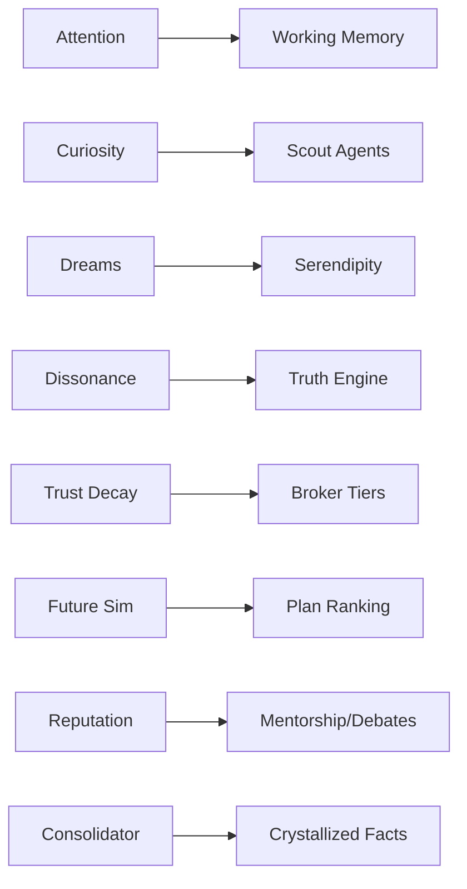

# 20 — Unique Cognitive Features Design

AETHER CORE's differentiation is its **native cognitive architecture** — engines that operate on the memory/graph substrate to produce behaviors no wrapper can. Each engine is a subsystem that reads/writes events and memory, and is itself observable. (AETHER SENTINEL lives in 08; SynthOS Mission Control in 10.)

## 1. Memory Dreams
During idle cycles, the daemon replays and recombines episodic/semantic memories to find latent structure.
- **Mechanism:** offline pass over low-salience clusters; generate hypotheses as `Reflection` records; strengthen `RELATED_TO` edges with discovered weight.
- **Output:** "dream log" surfaced in Memory Explorer; novel links proposed for validation.
- **Safety:** dreams are write-scoped to a staging tier; never auto-mutate crystallized facts.

## 2. Attention Engine
Allocates limited context budget across agents and memories by salience × recency × relevance.
- Maintains a global `salience` field; decay via Trust Decay.
- Decides which memories enter each agent's Working window and which graph regions to pre-fetch.
- Exposes the "attention focus" ring in the Brain Pane.

## 3. Curiosity Engine
Drives self-directed exploration when no user intent is active.
- Scores graph regions by **information gain** (uncertainty × connectivity).
- Spawns low-privilege "scout" agents to fill gaps (read-only).
- Logs exploration in Episodic; feeds Serendipity and Self-Generated Research.

## 4. Cognitive Dissonance Detector
Flags contradictions between facts, agent claims, and observations.
- Computes pairwise inconsistency over Semantic + Reflection via embedding opposition + logical checks.
- Emits `CognitiveEvent(dissonance)` → triggers Truth Engine resolution or human note.
- Tracks per-agent dissonance rate as a trust signal.

## 5. Cognitive Honeypots
Synthetic high-value-but-fake nodes (secrets, "critical" files) seeded in the graph.
- Any agent accessing them without legitimate scope trips Sentinel (Memory-Aware Security).
- Measures agent integrity; trains behavioral baselines; deters exfiltration.

## 6. Trust Decay
Continuous re-weighting of actors and facts.
- `trust(actor)` decays with failed/denied ops and dissonance; recovers with corroborated success.
- `confidence(fact)` decays with age unless re-validated; drives tier demotion to Cold.
- Directly feeds Broker approval tiers and Sentinel risk.

## 7. Reality Model / Digital Twin
A live, queryable model of the host system state (services, containers, processes, files, network).
- Maintained by eBPF + systemd events → graph nodes (Service/Container/File).
- Enables "what-if" reasoning and detects drift between intended and actual state.
- Backs the System Integrity Engine and Future Simulation.

## 8. Future Simulation Engine
Runs lightweight forward simulations of intended actions before execution.
- Clones the Digital Twin; applies candidate plan; scores outcomes (risk, success, side-effects).
- Returns ranked plans; high-risk branches routed to L2/L3 approval.
- Uses Monte-Carlo over uncertain graph edges for robustness.

## 9. Knowledge DNA
Each fact/entity gets a lineage signature tracing its provenance chain (CREATED_BY → DISCOVERED_BY → SUPERSEDES).
- Encoded as a compact hash "DNA" string; forks when contradicted; merges on consensus.
- Enables provenance-aware trust and contamination tracing (poisoned source → affected descendants).

## 10. Truth Engine
Arbiter of "what is currently believed true."
- Prefers **crystallized** facts; resolves dissonance via evidence weight + provenance trust + recency.
- Produces a `TruthState` per contested claim; surfaces confidence intervals in UI.
- Rejects claims whose Knowledge DNA traces to a poisoned/contradicted source.

## 11. Self-Generated Research
Autonomous research loops triggered by Curiosity/Dissonance/uncertain goals.
- Formulates hypotheses → spawns research agents (scoped `SearchCode`/`UseBrowser`/`AccessDatabase`) → synthesizes into Semantic/Reflection.
- Results feed Memory Dreams and Idea Incubator; capped by rate limits + Trust Decay.

## 12. Idea Incubator
Low-priority ideas are parked, nurtured, and periodically re-evaluated.
- Stores incubating ideas as `Reflection` with maturity score; Curiosity re-checks periodically.
- Promotes to active goal when supporting evidence/context matures; demotes/prunes otherwise.

## 13. Serendipity Engine
Deliberately introduces beneficial unexpectedness.
- Cross-pollinates distant graph regions (via Dreams/Curiosity) to surface non-obvious links.
- Measures "serendipity hits" (links later validated as useful) to tune its exploration temperature.

## 14. Personal Operating Theory (POT)
A living model of *how the user thinks and works*.
- Learns preferences, workflows, decision patterns from interactions → `Reflection` + graph `Person` props.
- Guides default scopes, routing, and UI framing; evolves via Trust Decay + feedback.

## 15. Model Routing
Selects the best provider/model per subtask under cost/latency/quality constraints.
- Scores providers by task type, reputation, cost; consults POT + budget.
- Transparent: every route recorded with rationale; fails over on outage (09).

## 16. Agent Reputation / Mentorship / Debates
- **Reputation:** trust/accuracy/helpfulness composite (Trust Decay-driven) per agent.
- **Mentorship:** high-reputation agents guide low-reputation ones (shared scoped context, not raw tokens).
- **Debates:** contested claims resolved by structured multi-agent debate; Truth Engine picks winner by evidence.

## 17. Semantic Process Manager
Replaces shell pipelines with **semantic processes** — named, memory-aware workflows as graph `Task`/`Goal` chains.
- Tracks state, dependencies (BLOCKED_BY/ENABLES), and provenance; pauses/resumes with the Event Log.
- Observability: each step is a traced, capability-checked intent (Mission Control tool timeline).

## 18. Memory Consolidator
The hygiene engine tying tiers together.
- Promotes Episodic→Semantic on salience×access; dedups by cosine<0.92; extracts Procedural skills.
- Crystallizes high-confidence facts; compresses Cold tier (zstd); prunes stale/low-value records.
- Runs continuously (low-priority) + on shutdown; reports a `ConsolidationReport`.

## Cross-Engine Flow

