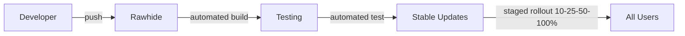

# Linux Solus — Release Plan

---

## Versioning Scheme

Linux Solus uses **Calendar Versioning** (CalVer):

```
YYYY.MM.REVISION
```

Examples:
- `2026.10.1` — October 2026, first revision
- `2027.03.0` — March 2027, initial release

LTS releases use: `YYYY.MM.LTS-REVISION`
- `2027.12.LTS-0` — December 2027 LTS

### Branch Naming

| Branch | Purpose | Lifecycle |
|--------|---------|-----------|
| `rawhide` | Development, bleeding edge | Continuous |
| `stable` | Current stable release | ~6 months |
| `lts` | Long-term support | 5 years |
| `updates` | Security + bug fixes for stable | Per-release |

---

## Release Cadence

| Type | Cadence | Support Window |
|------|---------|----------------|
| Stable Release | Every 6 months (Apr + Oct) | 9 months (overlap with next) |
| LTS Release | Every 2 years | 5 years |
| Point Release | As needed (bug fixes) | — |
| Security Update | Within 48 hours of CVE | — |
| Rolling (Rawhide) | Continuous | — |

---

## Release Naming

Linux Solus releases are named after **stars and constellations**.

| Version | Codename | Star |
|---------|----------|------|
| 2026.10 | "Ignition" | — (inaugural) |
| 2027.04 | "Sirius" | Sirius A |
| 2027.10 | "Vega" | Vega (α Lyrae) |
| 2028.04 | "Rigel" | Rigel (β Orionis) |
| 2028.10 | "Altair" | Altair (α Aquilae) |
| 2029.04 | "Capella" | Capella (α Aurigae) |
| 2029.10 | LTS "Polaris" | Polaris (α Ursae Minoris) |

---

## Release Checklist

### Pre-Release (T-4 weeks)

- [ ] Feature freeze declared
- [ ] String freeze declared
- [ ] Translation deadline
- [ ] Kernel freeze to latest LTS/stable tag
- [ ] Package versions pinned
- [ ] All meta-packages finalized
- [ ] ISO build pipeline verified
- [ ] QA test cycle begins

### Release Candidate (T-2 weeks)

- [ ] RC1 ISO built and published
- [ ] Open testing announced
- [ ] Bug tracker triage active
- [ ] Hardware compatibility testing
- [ ] Upgrade path testing
- [ ] Performance regression checks
- [ ] Security scan (OpenSCAP) passes
- [ ] Accessibility audit

### Final Release (T-0)

- [ ] Release ISO built
- [ ] SHA256 checksums generated
- [ ] GPG signatures applied
- [ ] Torrent files created
- [ ] Mirrors synced
- [ ] Release notes published
- [ ] Blog post / announcement
- [ ] Press kit distributed
- [ ] Social media campaign
- [ ] Docker images updated
- [ ] Vagrant boxes updated
- [ ] Cloud images (AWS, Azure, GCP)
- [ ] Documentation updated
- [ ] Known issues documented

### Post-Release (T+1 week)

- [ ] Point release 0.1 prepared (initial bug fixes)
- [ ] Community feedback review
- [ ] Survey distributed
- [ ] Metrics collection enabled
- [ ] Next release cycle begins

---

## Quality Gates

### Gate 1: Build
- [ ] ISO builds from clean checkout
- [ ] Build is reproducible (deterministic)
- [ ] All packages resolve dependencies
- [ ] No broken RPM dependencies

### Gate 2: Install
- [ ] ISO boots on UEFI + legacy BIOS
- [ ] Calamares completes installation
- [ ] GRUB/systemd-boot installs correctly
- [ ] LUKS encryption works
- [ ] BTRFS subvolumes created
- [ ] First boot completes without error

### Gate 3: Boot
- [ ] Boot time < 12 seconds (NVMe)
- [ ] Plymouth splash displays
- [ ] SDDM login screen displays
- [ ] Desktop session starts
- [ ] Network connectivity (WiFi + Ethernet)
- [ ] Sound output
- [ ] Display resolution detected correctly

### Gate 4: Package Management
- [ ] DNF5 update works
- [ ] Flatpak install/update works
- [ ] Solus repository reachable
- [ ] Package signing verified
- [ ] Rollback via DNF history works

### Gate 5: Security
- [ ] SELinux enforcing
- [ ] No SELinux denials on default boot
- [ ] Firewalld active
- [ ] Secure Boot passes
- [ ] Kernel lockdown integrity mode
- [ ] Auditd running
- [ ] All CVEs in base system patched

### Gate 6: Gaming
- [ ] Steam launches and installs game
- [ ] Proton GE runs DirectX game
- [ ] MangoHUD overlay operational
- [ ] Gamescope functional
- [ ] GPU drivers loaded correctly
- [ ] VulkanInfo passes

### Gate 7: Performance
- [ ] Boot time within 10% of target
- [ ] Idle RAM within 10% of target
- [ ] No performance regressions vs baseline
- [ ] Disk I/O within spec
- [ ] Package operations within spec

---

## Update Strategy

### Stable Updates



### Update Types

| Type | Description | Rollout | User Impact |
|------|-------------|---------|-------------|
| Security | Critical CVEs | Fast (24-48h) | Auto-install |
| Bugfix | Non-critical fixes | Weekly | Optional |
| Enhancement | New features | With release | Optional |
| Package | New upstream version | With release | Optional |

### Staged Rollout

1. **10%** — Solus team + early testers
2. **25%** — Opt-in beta group
3. **50%** — General population
4. **100%** — All users

Rollback at any stage if regression detected.

---

## Branch Management

```
main
├── rawhide (continuous development)
├── f42 (Fedora 42 base, active release)
│   ├── stable
│   ├── updates
│   └── security
├── f43 (next Fedora base)
└── lts/polaris-2029 (LTS branch)
    ├── 2.0.0
    ├── 2.0.1
    └── ...
```

### Git Flow

```
feature branches ──► rawhide
                        │
                        ▼
                 release/YYYY.MM  (tag: v2026.10.0)
                        │
                        ├──► stable
                        │
                        └──► hotfix/YYYY.MM.N  (tag: v2026.10.1)
```

---

## Infrastructure Requirements

### Build System
- 4x build servers (x86_64, 16+ cores, 64GB RAM)
- 1x ARM64 build server (for future aarch64 support)
- 500GB+ NVMe storage per builder
- 1Gbps+ network connection

### Repository
- CDN-backed mirror network
- 3+ continents (NA, EU, Asia)
- 5TB+ storage for packages + ISOs
- GPG signing hardware (HSM/YubiKey)

### CI/CD
- GitHub Actions / self-hosted runners
- Container registry for build environments
- Artifact storage (ISOs, packages)

---

## Cost Estimate (Monthly)

| Item | Cost | Notes |
|------|------|-------|
| Build servers | $400 | 4x Hetzner AX102 |
| CDN + storage | $200 | BunnyCDN + S3-compatible |
| Domain + DNS | $20 | solus-linux.org |
| CI/CD runners | $100 | GitHub Actions |
| Signing HSM | $50 | YubiKey + Nitrokey amortized |
| Developer stipends | $2000 | Open-source contributors |
| **Total** | **~$2770** | |

---

## Communication Plan

| Channel | Purpose | Launch |
|---------|---------|--------|
| solus-linux.org | Website + blog | Beta |
| GitHub | Code, issues, discussions | Now |
| Discord | Community chat | Alpha |
| Matrix | Open chat | Alpha |
| Reddit r/linuxsolus | Community | Beta |
| YouTube | Tutorials, showcases | Beta |
| Twitter/X | Announcements | Alpha |
| Mastodon | Fediverse presence | Alpha |
| Discourse | Forums | Beta |

---

<div align="center">
  <i>Linux Solus — Illuminate Your Desktop</i>
</div>
